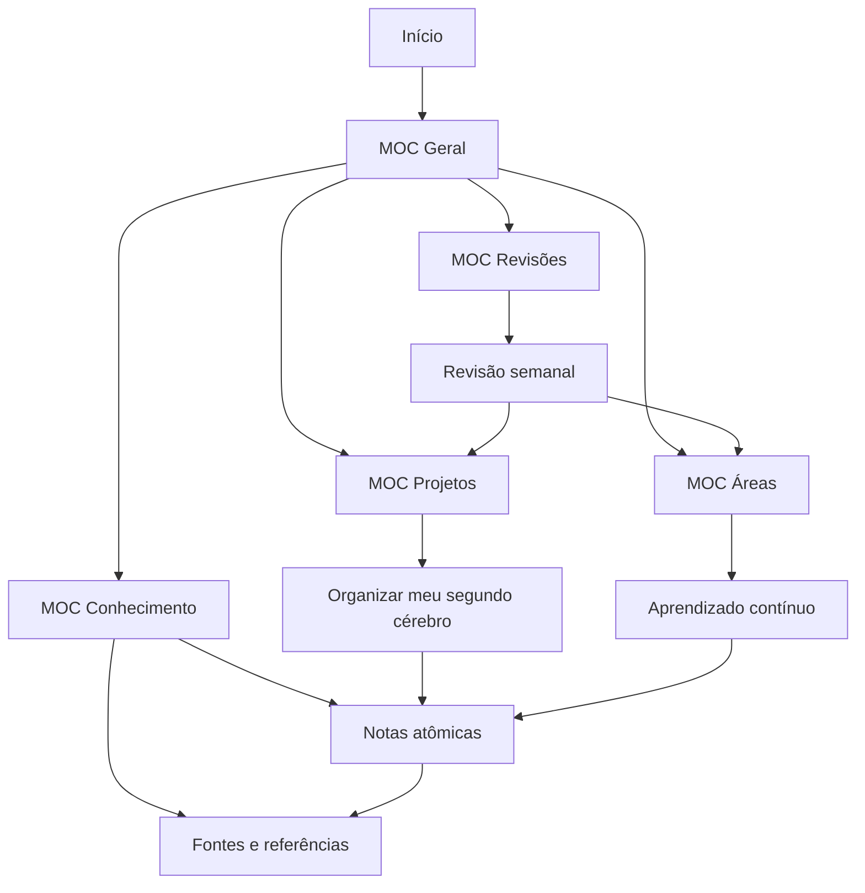

# MOC Geral

MOC significa *Map of Content*: uma nota que organiza caminhos para outras notas. Pastas guardam arquivos; MOCs dão contexto às conexões.

## Mapas principais

- [[MOC Projetos]] → o que quero concluir?
- [[MOC Areas]] → o que preciso manter?
- [[MOC Conhecimento]] → o que estou aprendendo?
- [[MOC Revisoes]] → o que precisa de atenção?

## Apoio

[[Inicio]] · [[Caixa de Entrada]] · [[Modelos]] · [[Arquivo]] · [[Como usar]]

## Visão das conexões

Este diagrama é ilustrativo e manual. O grafo do Obsidian é gerado pelos wikilinks reais e acompanha as novas conexões.
